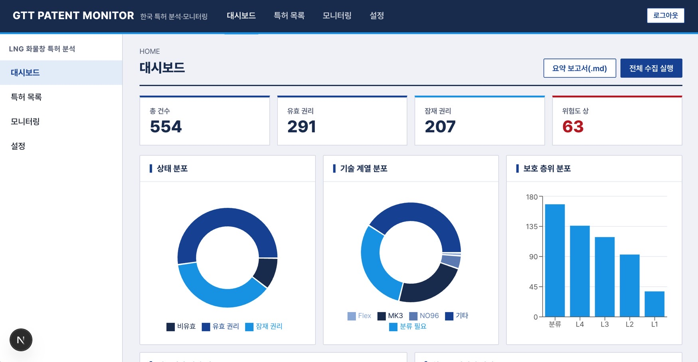

# GTT 한국 특허 분석·모니터링 (시연용)

LNG 화물창 단열시스템(GTT 계열) 한국 특허를 수집·분류·분석·모니터링하는 웹 애플리케이션입니다. 기술 명세서 v1.0 기준으로 구현했습니다.

> 본 자료는 공개 특허 정보 기반 1차 기술 검토 자료이며, 침해·회피 판단은 변리사 검토 대상입니다.

**스택**: Next.js 16 (App Router) · TypeScript · Tailwind CSS 4 · Neon Postgres + Drizzle ORM · KIPRIS Plus API · Claude API · Recharts · Vitest

## 주요 기능

| 화면 / 기능 | 내용 |
|---|---|
| 대시보드 | KPI 4종, 상태·계열·층위 분포, 연도별 출원 추이, 최근 모니터링 이벤트 |
| 특허 목록 | 상태군·계열·층위·위험도·검증·출원연도 필터, 명칭 검색, 정렬, CSV(UTF-8 BOM) |
| 특허 상세 | 서지 정보, 분류 근거 단어, 수동 분류(MANUAL 우선), 청구항 분해표, 상태 이력 |
| 모니터링 | 수동/Cron 실행, 신규·상태 변경·등록번호 부여 감지, 회차 보고서(.md), 시연용 "기준에서 1건 삭제" |
| 설정 | 출원인 별칭(검색식), 보조 IPC, 위험도 임계값, KIPRIS 연결 테스트 |

설계 원칙: **규칙은 코드, 판단은 LLM, 사실은 API.** 법적상태·번호·날짜는 KIPRIS 응답만 신뢰하고, 위험도는 결정적 규칙 함수(`lib/domain/risk.ts`)로만 계산합니다. LLM은 계열·층위 분류와 청구항 구성요소 분해에만 씁니다. UI와 보고서에는 "침해/비침해/무효" 같은 결론을 쓰지 않고(금지어 검사 포함) 모든 화면 하단에 고지 문구를 고정합니다.

## 이번 작업 요약

- 명세서의 M1~M5 범위를 구현: 인증(서명 쿠키 + `proxy.ts`), KIPRIS 클라이언트, 수집·분류·청구항 분해·모니터링 서비스, API/Cron 라우트, 6개 화면, 보고서 생성, 단위 테스트
- 삼성중공업 웹사이트·업무시스템 스타일(상단 GNB + 좌측 LNB + 조밀한 표)을 참고한 자체 UI 테마 적용 — 네이비 `#1E3A5F`, 블루 `#1A56A4`, 스카이 `#0EA5E9`
- 실제 KIPRIS 수집 결과: 출원인 별칭 4종 검색 → 중복 제거 후 **554건** 저장, Claude로 계열·층위 분류, 위험도 규칙 계산

## 오류 수정 내역

| # | 증상 | 원인 | 수정 |
|---|---|---|---|
| 1 | `next build` 실패 (`dynamic` 설정 불가) | 스캐폴드 기본값 `cacheComponents`가 Route Segment Config와 충돌 | `next.config.ts`에서 `cacheComponents`·`partialPrefetching` 제거 |
| 2 | `vitest` 설치 시 ERESOLVE | vitest 5가 `@types/node` 22 이상을 요구 | `@types/node@24`로 상향 |
| 3 | 마이그레이션 충돌 (`public.patents` 등) | 연결한 DB를 다른 앱과 공유 | 전용 **`gtt` 스키마**로 이전, 마이그레이션 이력 테이블도 `gtt`에 분리 (공용 `drizzle` 테이블과 타임스탬프가 섞이면 마이그레이션이 건너뛰어질 수 있음) |
| 4 | 수집이 첫 페이지에서 멈출 위험 (`totalCount`=1로 읽힘) | 실제 응답의 총 건수 위치는 `response.count.totalCount`인데 `response.body.count`를 읽음 | 파서 수정 + 픽스처·테스트를 실제 구조로 교체 (554건 정상 수집) |
| 5 | 웹 확인 시드 5건이 KIPRIS 레코드와 중복 | `KR102202778B1`에서 숫자만 추출할 때 종별코드 `B1`의 `1`이 섞여 등록번호 대조 실패 | `seedRegDigits()`로 종별코드 제외, 테스트 추가, 중복 5건 정리 |
| 6 | 분류 호출 400 (`tool_choice ... not supported`) | `claude-sonnet-5-5`는 도구 호출 강제(`tool_choice` any/tool) 미지원 | `tool_choice: auto` + 프롬프트 지시로 변경, Zod 검증·1회 재시도 유지, `effort: medium`, `max_tokens` 확대 |
| 7 | 분류 10건 중 8건이 `UNCLASSIFIED` | 근거 단어가 있어도 신뢰도를 0.45~0.55로 낮게 매김, `ETC`와 `UNCLASSIFIED` 혼용 | 프롬프트에 ETC 사용 기준·신뢰도 기준 명시 (시험 10건 중 미분류 0건) |
| 8 | 대시보드 UI 이상 | 카드 제목 정렬 어긋남, 계열 범례가 "Mark"로 중복 표기, 차트 진입 애니메이션 | 제목 막대를 제목 span에 결합, `FAMILY_SHORT` 라벨 도입, 차트 애니메이션 비활성화 |

## 알려진 한계 / 다음 작업

- 출원인 별칭 4종이 모두 같은 554건을 반환합니다(KIPRIS가 출원인명을 정규화). 호출이 4배로 중복되므로 별칭 정리 또는 수집 로직 개선 여지가 있습니다.
- KIPRIS 청구항 필드(`getBibliographyDetailInfoSearch`)는 실제 응답으로 아직 검증하지 못했습니다. 비어 있으면 상세 화면의 수동 입력을 사용합니다.
- 분류는 명칭·요약만 근거로 하므로 신뢰도가 낮은 건은 수동 확인이 필요합니다.
- 로컬 시연용 공유 비밀번호 인증입니다. 운영 시 Auth.js 등으로 교체하세요.

## 시작하기

1. `.env.example`을 참고해 `.env.local` 작성: `DATABASE_URL`(Neon), `KIPRIS_PLUS_API_KEY`, `ANTHROPIC_API_KEY`, `CRON_SECRET`, `APP_PASSWORD`, `SESSION_SECRET`
2. 스키마 적용 및 시드
   ```bash
   npm run db:migrate   # gtt 스키마 + pg_trgm + 마이그레이션
   npm run db:seed      # 별칭·설정·웹 확인 5건
   ```
3. `npm run dev` → 설정 화면에서 **KIPRIS 연결 테스트** → 대시보드에서 **전체 수집 실행**

| 명령 | 설명 |
|---|---|
| `npm run dev` | 개발 서버 |
| `npm test` | Vitest (위험도·diff·정규화·AI 출력 검증) |
| `npm run build` | 프로덕션 빌드 |
| `npm run db:generate` | 스키마 변경 시 마이그레이션 SQL 생성 |

## 배포 (Vercel)

- GitHub 저장소를 Vercel에 Import (Framework: Next.js 자동 인식)
- Environment Variables에 위 `.env.local` 항목 등록 (`NEXT_PUBLIC_` 접두사 금지)
- DB 마이그레이션은 로컬에서 `npm run db:migrate`로 먼저 적용
- Cron: `vercel.json` — `0 22 * * 0` (UTC, 월요일 07:00 KST), 함수 리전 `icn1`
- 시연용 `APP_PASSWORD`는 운영 배포 전에 강한 값으로 교체하세요.
